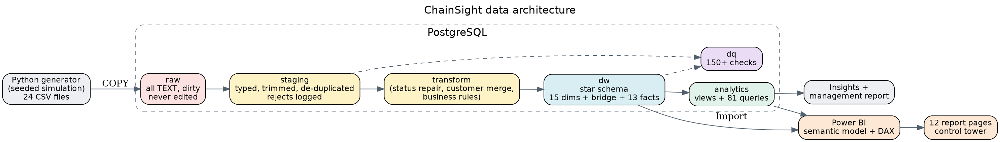
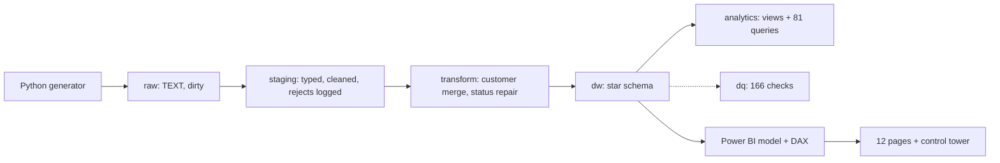
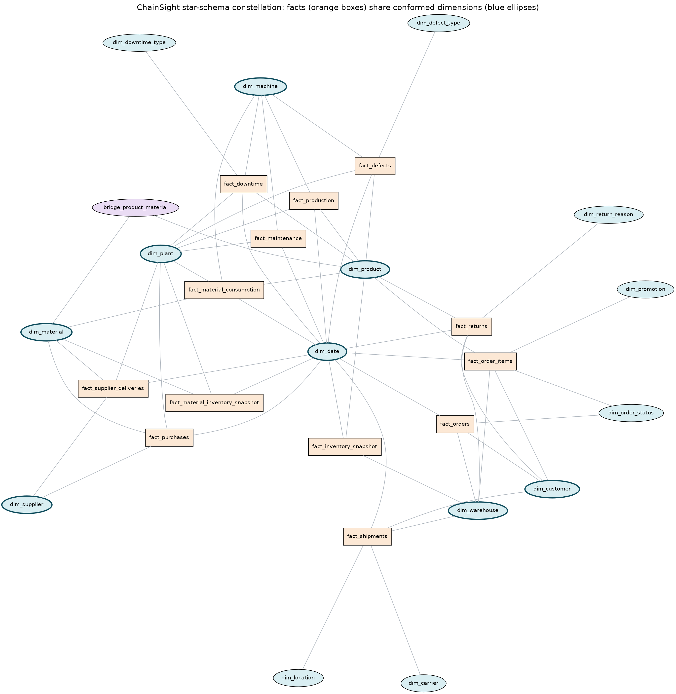

# ChainSight: E-Commerce, Supply Chain & Manufacturing Intelligence Platform

An end-to-end Business Intelligence project: a seeded simulation of a consumer-electronics manufacturer that sells online, a PostgreSQL warehouse built with SQL (raw, staging, star schema), 81 analytical queries, 166 automated data-quality checks, and a complete Power BI design (model, about 200 DAX measures, 12 page specifications) with a supply-chain **control tower**.

> **The data is synthetic.** NovaTech Manufacturing & Commerce is fictional. Findings show how the analysis works, not facts about a real company.



## 1. Business problem

NovaTech buys components, builds products in 5 plants, stores them in 15 warehouses and ships web orders worldwide. Leadership sees revenue, but cannot see **why** an order is late, a product is out of stock or margin is falling, because the causes sit in other departments. ChainSight connects the whole chain so a problem can be traced back to its source:

`Supplier -> PO -> Raw material -> Machine -> Quality -> Finished goods -> Warehouse -> Order -> Shipment -> Delivery -> Return`

## 2. What is in the repository

| Area | What it contains |
|---|---|
| `scripts/generate_data.py` | Day-by-day simulation with a fixed seed and configurable scale; writes 24 dirty CSV files |
| `sql/01..08` | Schemas, raw tables, staging, dimensions, facts, quality checks, indexes and foreign keys, 81 analytical queries + views |
| `scripts/run_pipeline.py` | One command: load, clean, model, check, index |
| `scripts/validate_project.py` | Full validation, writes `docs/validation_report.md` |
| `powerbi/` | Model specification, Power Query scripts, DAX library (10 folders), 12 page specifications, theme |
| `docs/` | Requirements, architecture, dimensional model, data dictionary, ETL, KPIs, insights, management report, performance, validation, Power BI build guide, interview guide, resume |
| `diagrams/` | Architecture, ER and star-schema diagrams (PNG + SVG, generated from the live database) |

## 3. Tech stack

PostgreSQL 16, SQL, Python (pandas, NumPy, psycopg2; only for data generation and orchestration), Power BI + DAX, Docker Compose, Graphviz. No machine learning.

## 4. Architecture



Details: [docs/architecture.md](docs/architecture.md).

## 5. Dataset (seed 42, scale 1.0)

| Entity | Rows | Entity | Rows |
|---|---|---|---|
| Customers | 20,000 | Shipments | 231,695 |
| Products | 500 | Returns | 39,111 |
| Orders | 249,836 | Inventory snapshots (weekly) | 1,177,383 |
| Order lines | 598,833 | Purchase-order lines | 57,018 |
| Production runs | 121,081* | Downtime events | 140,091 |
| Material consumption | 561,311 | Machines / plants / warehouses | 110 / 5 / 15 |

\*see [docs/data_generation.md](docs/data_generation.md) for exact counts. The stretch target of 300,000 production records was not reached at run grain (121,081 runs, because production is demand-driven); detail volume is carried by material consumption and downtime events. Use `--scale` to change volumes.

## 6. Data model

13 facts and 15 dimensions plus a bridge, in a constellation of stars with conformed dimensions. Grain of each fact is stated in one sentence and enforced with a UNIQUE constraint.



| Fact | Grain |
|---|---|
| fact_orders | one customer order |
| fact_order_items | one product line in an order |
| fact_shipments | one shipment |
| fact_returns | one return record on one order line |
| fact_inventory_snapshot | one product, one warehouse, one weekly snapshot |
| fact_material_inventory_snapshot | one material, one plant, one weekly snapshot |
| fact_purchases | one purchase-order line |
| fact_supplier_deliveries | one delivery receipt |
| fact_production | one product on one machine in one shift on one date |
| fact_material_consumption | one material used by one production run |
| fact_downtime | one downtime event |
| fact_maintenance | one maintenance work order |
| fact_defects | one defect type within one production run |

Full documentation: [dimensional model](docs/dimensional_model.md), [data dictionary](docs/data_dictionary.md), [KPI definitions](docs/kpis.md).

## 7. Data quality handling

The RAW layer deliberately contains NULLs, duplicates, bad dates, inconsistent labels, invalid statuses, negative quantities, orphan ids, duplicate customers and whitespace. Staging fixes or rejects each and logs every removed row with a reason; `raw = staging + rejects` is tested for every table. The warehouse is checked by 166 automated tests (NULL keys, orphans, grain duplicates, impossible values, dates, statuses, KPI identities). See [docs/etl.md](docs/etl.md) and [docs/validation_report.md](docs/validation_report.md).

## 8. SQL analytics

81 queries in `sql/08_analytics`: e-commerce (Q01-Q16), customers (Q17-Q26), inventory (Q27-Q38), suppliers (Q39-Q47), manufacturing (Q48-Q61), logistics (Q62-Q67) and cross-domain (Q68-Q81). Each states the business question. Run them all with `python scripts/run_queries.py`, or one with `--show Q15`.

SQL skills shown: joins, CTEs, subqueries, window functions (ROW_NUMBER, RANK, DENSE_RANK, NTILE, LAG, SUM/AVG OVER), conditional aggregation (FILTER), HAVING, date functions, views, covering and partial indexes, EXPLAIN ANALYZE ([docs/performance.md](docs/performance.md)).

## 9. Power BI

Import mode, single-direction relationships, 69 relationships including 10 inactive role-playing date relationships, hidden BOM bridge, marked Date table. About 200 measures in 10 display folders (e-commerce, customers, inventory, suppliers, manufacturing, logistics, time intelligence, demand & supply, control tower, alternate dates).

| Page | Question |
|---|---|
| 1 Executive Command Center | How is the company doing? |
| 2 E-Commerce | What drives revenue and margin? |
| 3 Customers | Who is valuable, who is leaving? |
| 4 Inventory & Warehouse | Where is stock too low or high? |
| 5 Suppliers | Which suppliers show risk? |
| 6 Manufacturing | Which plants lose efficiency? |
| 7 Machines & Maintenance | Which machines and causes lose output? |
| 8 Logistics | Warehouse delay or carrier delay? |
| 9 Demand & Supply | Which products will run short? |
| 10 Control Tower | Where is the chain breaking, and why? |
| 11 Investigate Product (drill-through) | Follow one product through the chain |

> **Screenshots:** placeholder. Build the report with [docs/powerbi_build_guide.md](docs/powerbi_build_guide.md) and save images in `reports/`.
>
> 

## 10. Key findings (details in [docs/insights.md](docs/insights.md))

* 2025 revenue +9.2% but gross profit flat: margin 36.7% to 33.6%; Audio margin fell 10 points as its discount rate rose from 4% to 12%.
* Order value cancelled or backordered tripled to $3.6M in 2025; Chicago and Mumbai warehouses run 29% and 20% stockout.
* 63% of lost machine hours are waiting for material; a 2024 supplier disruption coincides with a production and stock squeeze.
* Plant OEE ranges from 55.7% to 74.0%; 9 machines fail 3-7x more than average; maintenance is 83-89% reactive.
* Higher-defect products are returned more (correlation 0.64, association only).

## 11. Setup and run

Requirements: Python 3.10+, PostgreSQL 16 (or Docker), about 2 GB free disk, 4 GB RAM.

```bash
# 1. environment
python -m venv .venv
source .venv/bin/activate          # Windows PowerShell: .venv\Scripts\Activate.ps1
pip install -r requirements.txt

# 2. configuration (choose your own password)
cp .env.example .env               # Windows: copy .env.example .env  then edit POSTGRES_PASSWORD

# 3. database (Docker)
docker compose up -d               # or use your own PostgreSQL and match the .env values

# 4. generate data and build everything (about 3 minutes)
python scripts/run_pipeline.py --generate            # add --scale 0.1 for a quick demo

# 5. check and explore
python scripts/validate_project.py                   # writes docs/validation_report.md
python scripts/run_queries.py                        # runs all 81 queries
python scripts/run_queries.py --show Q15             # print one result
```

If you use your own PostgreSQL instead of Docker: create the role and database named in `.env` (`CREATE ROLE chainsight LOGIN PASSWORD '...'; CREATE DATABASE chainsight OWNER chainsight;`).

Restart from any step: `python scripts/run_pipeline.py --from staging` (steps: setup, raw, load, staging, dimensions, facts, quality, indexes, analytics).

Regenerate docs and diagrams: `python scripts/generate_data_dictionary.py`, `generate_model_doc.py`, `generate_diagrams.py` (needs Graphviz), `kpi_reference.py`.

## 12. Connect Power BI

1. Server `localhost:5432`, database `chainsight`, **Import**, Database credentials (user and password from `.env`).
2. Follow [docs/powerbi_build_guide.md](docs/powerbi_build_guide.md): load queries from `powerbi/model/power_query_load.m.txt`, create relationships from `powerbi/model/model_specification.md`, add measures from `powerbi/dax/`, apply `powerbi/theme/chainsight_theme.json`, build pages from `powerbi/dashboard_specs/`.
3. Check your cards against [docs/kpi_reference_values.md](docs/kpi_reference_values.md).

## 13. Repository structure

```
chainsight-bi/
├── README.md  docker-compose.yml  requirements.txt  Makefile  .env.example  .gitignore
├── data/            raw/ (generated CSVs, git-ignored), processed/ (manifest)
├── scripts/         generate_data.py, load_data.py, run_pipeline.py, run_queries.py, validate_project.py,
│                    kpi_reference.py, generate_* (docs and diagrams), db.py
├── sql/             01_setup 02_raw 03_staging 04_dimensions 05_facts 06_quality 07_indexes 08_analytics
├── powerbi/         dax/ model/ dashboard_specs/ theme/
├── docs/            business_requirements, architecture, dimensional_model, data_dictionary, etl, data_generation,
│                    kpis, kpi_reference_values, insights, management_report, performance, validation_report,
│                    powerbi_build_guide, interview_guide, resume
├── diagrams/        architecture, er_diagram, star_schema (png + svg)
└── reports/         screenshots (after you build the report)
```

## 14. Challenges

* **Making the simulation behave.** Getting stockouts, cancellations and utilisation to look realistic across three growing years took repeated calibration (capacity headroom, pull-based production, demand-based purchasing).
* **Honest metrics.** Defining revenue (recognised at shipment), OEE (from sums), stock (last snapshot) and supplier bands so SQL, DAX and documentation agree.
* **Right-censoring and start-up effects.** Newer customers have less time to repeat; January 2023 is inflated by simulation start-up. Both are documented rather than hidden.

## 15. Limitations and honest notes

* Data is synthetic; correlations in the insights are associations, not proven causes.
* The Power BI `.pbix` is **not** included: it must be built in Power BI Desktop from the specifications. DAX was written against the model and verified by matching SQL logic, but it has not been executed in Power BI here.
* `docker-compose.yml` was not executed in the build environment; the pipeline was validated on a local PostgreSQL 16 server (full scale and `--scale 0.1`).
* Inventory ageing is a "days since last sale" proxy because lot-level age is not in the data.

## 16. Future improvements

Type 2 history for product price and customer region; incremental loads; a forecast baseline for expected demand (SQL first); lot-level inventory; operator dimension; CI that runs `validate_project.py`; row-level security in Power BI; scheduled refresh through a gateway.
