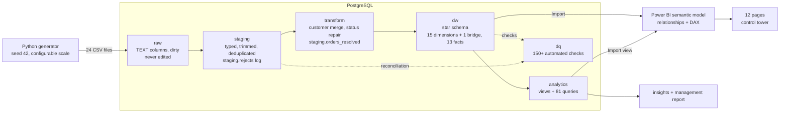

# Architecture

## Layers

| Layer | Schema | What happens here | Why |
|---|---|---|---|
| Source | CSV files | Generated by `scripts/generate_data.py`; a few percent of rows in each table are deliberately dirty | Realistic input |
| RAW | `raw` | One table per file, **every column TEXT**, loaded with `COPY` | The raw layer must accept anything. If a bad date broke the load, you would lose the evidence |
| STAGING | `staging` | Cast types, trim/collapse whitespace, standardise case and labels, drop duplicates, validate keys. Every removed or merged row is written to `staging.rejects` with a reason | Cleaning is visible and auditable |
| TRANSFORM | `staging` (`orders_resolved`, `customer_map`) | Business rules: merge duplicate customers, repair invalid order status from shipment evidence | Keeps rules out of the dimensional load |
| WAREHOUSE | `dw` | Surrogate keys, dimensions, facts, indexes, declared foreign keys, comments | Clean, fast, documented |
| ANALYTICS | `analytics` | Views for demand-vs-supply, supplier scorecard and OEE; 81 query files | Reusable logic, SQL proof of every KPI |
| QUALITY | `dq` | `dq.check_results`: reconciliation, NULL keys, orphans, duplicates and grain, impossible values, dates, statuses, KPI identities | Nothing reaches Power BI unchecked |
| BI | Power BI | Import mode, star schema, DAX measures, 12 pages | The user-facing product |

## Design principles

1. **Raw is evidence, staging is judgement, the warehouse is trusted.** Dirty data never enters `dw`.
2. **Nothing disappears silently.** `raw rows = staging rows + rejects` is a tested rule for every cleaned table.
3. **Grain first.** Every fact has a one-sentence grain, enforced by a UNIQUE constraint.
4. **Surrogate keys** (integers) in the warehouse; business keys are kept for traceability and unique-indexed.
5. **Rebuild, don't patch.** Every layer script drops and recreates what it owns, so the pipeline can run from any step with `--from`.
6. **Indexes after loading**, only where a query pattern needs them.

## Data flow of one order, as a worked example

1. `raw.orders` holds `ORD-0001234` with status `delivrd` and customer `C9xxxxx` (a duplicate account).
2. Staging maps `delivrd` to `Delivered` and `C9xxxxx` to the surviving customer id via `staging.customer_map`.
3. `staging.orders_resolved` confirms the status from the shipment record.
4. `dw.fact_orders` / `dw.fact_order_items` store the order with surrogate keys to customer, warehouse, product, promotion, status and dates.
5. Power BI reads `Orders` and `Order Items`; `[Total Revenue]` sums `recognized_revenue`.
