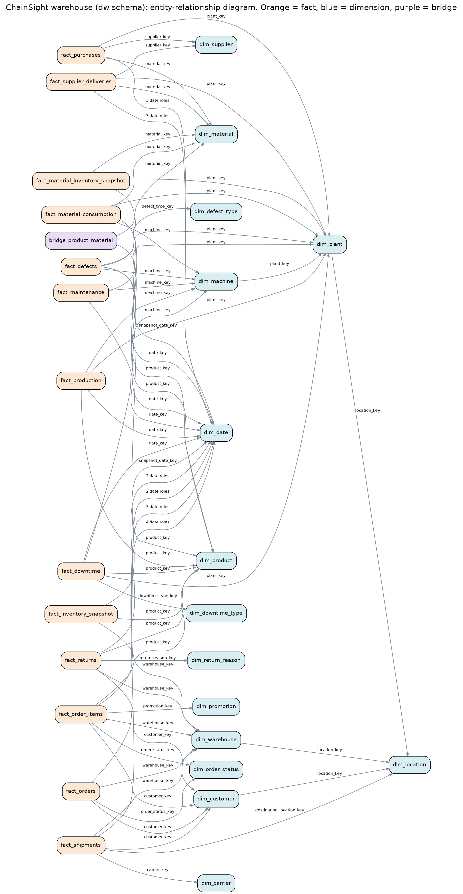

# Dimensional Model

Generated by `scripts/generate_model_doc.py` from the live warehouse (foreign keys and columns come from the PostgreSQL catalog), so it always matches the database.

## Modelling decisions (and what an interviewer may ask)

| Decision | Reason |
|---|---|
| Constellation of stars: 13 facts, shared (conformed) dimensions | Each business process has its own grain; shared Date, Product, Warehouse, Plant, Customer, Material, Supplier and Machine let you compare processes |
| Surrogate integer keys + business keys kept | Small, fast joins and insulation from source changes; business keys stay unique-indexed for traceability |
| Category inside `dim_product` (no `dim_category`) | Star not snowflake: fewer joins, a single hierarchy, simpler Power BI model |
| Weekly periodic snapshots for inventory | Stock is a state, not an event; snapshots make stockout, cover and trend queries simple. Weekly keeps 1.2M rows rather than 3.6M |
| Revenue recognised at shipment (`recognized_revenue`) | Cancelled and backordered orders must not inflate revenue, but their value is needed to measure revenue lost |
| Degenerate dimensions (`order_id`, `po_number`, `run_id`) kept on the fact | They have no attributes worth a dimension |
| Type 1 dimensions (overwrite) | The source holds no history. If product price or customer address history mattered, `dim_product` and `dim_customer` would become Type 2 (add valid_from, valid_to, is_current) |
| Bridge for BOM | Product-material is a true many-to-many; a bridge keeps both facts and dimensions at their natural grain |
| No fact-to-fact relationships | Facts are combined through conformed dimensions, never joined directly (avoids fan-out and double counting) |

## Fact tables

### `fact_orders`

* **Business process:** Order-to-cash
* **Grain:** One row per customer order.
* **Key strategy:** order_key (surrogate); order_id degenerate dimension, UNIQUE
* **Rows:** 249,836
* **Why it exists:** Order-level measures: order counts, cancellation, fulfilment speed, customer order sequence (new vs returning, cohorts). Revenue by product is read from fact_order_items.
* **Measures / additive columns:** `order_count`, `line_count`, `units`, `gross_amount`, `discount_amount`, `net_amount`, `cogs_amount`, `gross_profit_amount`, `recognized_revenue`, `recognized_cogs`, `recognized_gross_profit`, `days_to_ship`
* **Foreign keys (declared in PostgreSQL):** `customer_key` -> `dim_customer`, `order_date_key` -> `dim_date`, `order_status_key` -> `dim_order_status`, `promised_date_key` -> `dim_date`, `ship_date_key` -> `dim_date`, `warehouse_key` -> `dim_warehouse`
* **Related dimensions:** customer, date, order_status, warehouse

### `fact_order_items`

* **Business process:** Order-to-cash
* **Grain:** One row per product line within an order.
* **Key strategy:** order_item_key (surrogate); order_item_id UNIQUE; order_key links to fact_orders
* **Rows:** 598,833
* **Why it exists:** Product-level revenue, margin and discount analysis. Carries order status and dispatch delay so product problems can be sliced.
* **Measures / additive columns:** `quantity`, `unit_price`, `discount_pct`, `gross_amount`, `discount_amount`, `net_amount`, `cogs_amount`, `gross_profit_amount`, `recognized_revenue`, `recognized_cogs`, `recognized_gross_profit`
* **Foreign keys (declared in PostgreSQL):** `customer_key` -> `dim_customer`, `order_date_key` -> `dim_date`, `order_status_key` -> `dim_order_status`, `product_key` -> `dim_product`, `promotion_key` -> `dim_promotion`, `ship_date_key` -> `dim_date`, `warehouse_key` -> `dim_warehouse`
* **Related dimensions:** customer, date, order_status, product, promotion, warehouse

### `fact_shipments`

* **Business process:** Outbound logistics
* **Grain:** One row per shipment (one per shipped order).
* **Key strategy:** shipment_key (surrogate); shipment_id UNIQUE
* **Rows:** 231,695
* **Why it exists:** Delivery speed, carrier and warehouse reliability, shipping cost.
* **Measures / additive columns:** `shipment_count`, `shipping_cost`, `weight_kg`, `days_to_ship`, `transit_days`, `order_to_delivery_days`, `days_late`, `on_time_flag`, `delayed_flag`
* **Foreign keys (declared in PostgreSQL):** `carrier_key` -> `dim_carrier`, `customer_key` -> `dim_customer`, `delivered_date_key` -> `dim_date`, `destination_location_key` -> `dim_location`, `order_date_key` -> `dim_date`, `promised_date_key` -> `dim_date`, `ship_date_key` -> `dim_date`, `warehouse_key` -> `dim_warehouse`
* **Related dimensions:** carrier, customer, date, location, warehouse

### `fact_returns`

* **Business process:** Returns
* **Grain:** One row per return record against one order line.
* **Key strategy:** return_key (surrogate); return_id UNIQUE
* **Rows:** 39,111
* **Why it exists:** Return rate and reasons, linked to product, customer and warehouse.
* **Measures / additive columns:** `quantity_returned`, `refund_amount`, `days_to_return`, `restocked_flag`
* **Foreign keys (declared in PostgreSQL):** `customer_key` -> `dim_customer`, `order_date_key` -> `dim_date`, `product_key` -> `dim_product`, `return_date_key` -> `dim_date`, `return_reason_key` -> `dim_return_reason`, `warehouse_key` -> `dim_warehouse`
* **Related dimensions:** customer, date, product, return_reason, warehouse

### `fact_inventory_snapshot`

* **Business process:** Inventory management
* **Grain:** One row per product, per warehouse, per weekly (Sunday) snapshot.
* **Key strategy:** inventory_key (surrogate); UNIQUE (snapshot_date_key, product_key, warehouse_key)
* **Rows:** 1,177,383
* **Why it exists:** Periodic snapshot: stock levels are semi-additive (never sum across dates).
* **Measures / additive columns:** `qty_on_hand`, `qty_backordered`, `qty_in_transit`, `inventory_value`, `units_ordered_week`, `demand_4w`, `days_of_cover`, `days_since_last_sale`, `stockout_flag`, `low_stock_flag`, `excess_flag`, `excess_qty`, `excess_value`
* **Foreign keys (declared in PostgreSQL):** `product_key` -> `dim_product`, `snapshot_date_key` -> `dim_date`, `warehouse_key` -> `dim_warehouse`
* **Related dimensions:** date, product, warehouse

### `fact_material_inventory_snapshot`

* **Business process:** Raw material inventory
* **Grain:** One row per material, per plant, per weekly snapshot.
* **Key strategy:** material_inventory_key (surrogate); UNIQUE (snapshot_date_key, plant_key, material_key)
* **Rows:** 38,622
* **Why it exists:** Raw-material cover; connects supplier delays to production.
* **Measures / additive columns:** `qty_on_hand`, `qty_on_order`, `inventory_value`, `consumption_4w`, `days_of_supply`, `low_supply_flag`
* **Foreign keys (declared in PostgreSQL):** `material_key` -> `dim_material`, `plant_key` -> `dim_plant`, `snapshot_date_key` -> `dim_date`
* **Related dimensions:** date, material, plant

### `fact_purchases`

* **Business process:** Procurement
* **Grain:** One row per purchase-order line (one material, one supplier, one plant).
* **Key strategy:** purchase_key (surrogate); po_line_id UNIQUE; po_number degenerate
* **Rows:** 57,018
* **Why it exists:** Spend, price variance, open orders.
* **Measures / additive columns:** `quantity_ordered`, `unit_price`, `ordered_amount`, `standard_amount`, `price_variance_amount`, `promised_lead_days`, `qty_received`, `qty_rejected`, `received_flag`
* **Foreign keys (declared in PostgreSQL):** `first_received_date_key` -> `dim_date`, `material_key` -> `dim_material`, `order_date_key` -> `dim_date`, `plant_key` -> `dim_plant`, `promised_date_key` -> `dim_date`, `supplier_key` -> `dim_supplier`
* **Related dimensions:** date, material, plant, supplier

### `fact_supplier_deliveries`

* **Business process:** Goods receipt
* **Grain:** One row per delivery receipt against a purchase-order line.
* **Key strategy:** delivery_key (surrogate); receipt_id UNIQUE
* **Rows:** 56,141
* **Why it exists:** Supplier on-time, lead time and quality.
* **Measures / additive columns:** `delivery_count`, `qty_received`, `qty_rejected`, `qty_accepted`, `received_value`, `actual_lead_days`, `promised_lead_days`, `days_late`, `on_time_flag`, `late_flag`, `in_full_flag`
* **Foreign keys (declared in PostgreSQL):** `material_key` -> `dim_material`, `order_date_key` -> `dim_date`, `plant_key` -> `dim_plant`, `promised_date_key` -> `dim_date`, `received_date_key` -> `dim_date`, `supplier_key` -> `dim_supplier`
* **Related dimensions:** date, material, plant, supplier

### `fact_production`

* **Business process:** Manufacturing
* **Grain:** One row per production run = one product on one machine in one shift on one date.
* **Key strategy:** production_key (surrogate); run_id UNIQUE; UNIQUE (date_key, shift, machine_key)
* **Rows:** 121,081
* **Why it exists:** OEE (availability x performance x quality), capacity, supply-driven loss.
* **Measures / additive columns:** `planned_minutes`, `operating_minutes`, `downtime_minutes`, `material_shortage_minutes`, `equipment_failure_minutes`, `changeover_minutes`, `capacity_units`, `ideal_units`, `total_units`, `good_units`, `defect_units`
* **Foreign keys (declared in PostgreSQL):** `date_key` -> `dim_date`, `machine_key` -> `dim_machine`, `plant_key` -> `dim_plant`, `product_key` -> `dim_product`
* **Related dimensions:** date, machine, plant, product

### `fact_material_consumption`

* **Business process:** Manufacturing (derived)
* **Grain:** One row per material consumed by one production run (units made x bill of materials).
* **Key strategy:** consumption_key (surrogate); UNIQUE (production_key, material_key)
* **Rows:** 561,311
* **Why it exists:** Links finished goods to the raw materials and suppliers they depend on.
* **Measures / additive columns:** `quantity_consumed`, `consumption_value`
* **Foreign keys (declared in PostgreSQL):** `date_key` -> `dim_date`, `machine_key` -> `dim_machine`, `material_key` -> `dim_material`, `plant_key` -> `dim_plant`, `product_key` -> `dim_product`
* **Related dimensions:** date, machine, material, plant, product

### `fact_downtime`

* **Business process:** Machine downtime
* **Grain:** One row per downtime event (one cause within one production run).
* **Key strategy:** downtime_key (surrogate); downtime_id UNIQUE
* **Rows:** 140,091
* **Why it exists:** Downtime Pareto, machine ranking, production loss.
* **Measures / additive columns:** `duration_minutes`, `duration_hours`, `lost_units_est`, `is_planned_flag`
* **Foreign keys (declared in PostgreSQL):** `date_key` -> `dim_date`, `downtime_type_key` -> `dim_downtime_type`, `machine_key` -> `dim_machine`, `plant_key` -> `dim_plant`, `product_key` -> `dim_product`
* **Related dimensions:** date, downtime_type, machine, plant, product

### `fact_maintenance`

* **Business process:** Maintenance
* **Grain:** One row per maintenance work order on one machine.
* **Key strategy:** maintenance_key (surrogate); work_order_id UNIQUE
* **Rows:** 10,914
* **Why it exists:** Maintenance frequency, preventive vs corrective mix, cost.
* **Measures / additive columns:** `work_order_count`, `corrective_flag`, `duration_hours`, `cost`
* **Foreign keys (declared in PostgreSQL):** `date_key` -> `dim_date`, `machine_key` -> `dim_machine`, `plant_key` -> `dim_plant`
* **Related dimensions:** date, machine, plant

### `fact_defects`

* **Business process:** Quality inspection
* **Grain:** One row per defect type recorded within one production run.
* **Key strategy:** defect_key (surrogate); UNIQUE (production_key, defect_type_key)
* **Rows:** 18,331
* **Why it exists:** Defect analysis by type, product, machine.
* **Measures / additive columns:** `defect_qty`, `scrap_cost`
* **Foreign keys (declared in PostgreSQL):** `date_key` -> `dim_date`, `defect_type_key` -> `dim_defect_type`, `machine_key` -> `dim_machine`, `plant_key` -> `dim_plant`, `product_key` -> `dim_product`
* **Related dimensions:** date, defect_type, machine, plant, product

## Dimension tables and bridge

### `dim_date`

* **Purpose:** Calendar: every day 2023-2026 with week, month, quarter, fiscal fields and sort columns.
* **Surrogate key:** date_key (yyyymmdd int)
* **Business key:** full_date
* **History handling:** Role-playing: used by all facts, several times in some.
* **Rows:** 1,461
* **Attributes:** `full_date`, `day_of_month`, `day_name`, `day_of_week_num`, `iso_week`, `week_start_date`, `month_num`, `month_name`, `month_short`, `month_year`, `month_year_sort`, `month_start_date`, `quarter_num`, `quarter_year`, `quarter_year_sort`, `year_num`, `fiscal_year`, `fiscal_quarter`, `is_weekend`, `is_month_end`, `is_actuals`
* **Used by facts:** `fact_defects`, `fact_downtime`, `fact_inventory_snapshot`, `fact_maintenance`, `fact_material_consumption`, `fact_material_inventory_snapshot`, `fact_order_items`, `fact_orders`, `fact_production`, `fact_purchases`, `fact_returns`, `fact_shipments`, `fact_supplier_deliveries`

### `dim_customer`

* **Purpose:** Who buys. Includes first-order cohort and behavioural segment as of 2025-12-31.
* **Surrogate key:** customer_key
* **Business key:** customer_id
* **History handling:** Type 1. Duplicates merged in staging.
* **Rows:** 20,000
* **Attributes:** `customer_id`, `first_name`, `last_name`, `full_name`, `email`, `marketing_opt_in`, `signup_date`, `city`, `country`, `region`, `first_order_date`, `cohort_month`, `last_order_date`, `lifetime_orders`, `customer_segment`
* **Used by facts:** `fact_order_items`, `fact_orders`, `fact_returns`, `fact_shipments`

### `dim_product`

* **Purpose:** What we sell. Category and sub-category are attributes here (star, not snowflake).
* **Surrogate key:** product_key
* **Business key:** product_id
* **History handling:** Type 1.
* **Rows:** 500
* **Attributes:** `product_id`, `sku`, `product_name`, `category`, `sub_category`, `list_price`, `current_unit_cost`, `weight_kg`, `launch_date`, `price_tier`, `primary_plant`
* **Used by facts:** `bridge_product_material`, `fact_defects`, `fact_downtime`, `fact_inventory_snapshot`, `fact_material_consumption`, `fact_order_items`, `fact_production`, `fact_returns`

### `dim_supplier`

* **Purpose:** Who supplies raw materials; S000 stands for 'supplier missing in source'.
* **Surrogate key:** supplier_key
* **Business key:** supplier_id
* **History handling:** Type 1.
* **Rows:** 111
* **Attributes:** `supplier_id`, `supplier_name`, `country`, `supplier_tier`, `payment_terms_days`, `quoted_lead_time_days`
* **Used by facts:** `fact_purchases`, `fact_supplier_deliveries`

### `dim_material`

* **Purpose:** Raw materials and components.
* **Surrogate key:** material_key
* **Business key:** material_id
* **History handling:** Type 1.
* **Rows:** 68
* **Attributes:** `material_id`, `material_name`, `material_family`, `standard_cost`, `unit_of_measure`
* **Used by facts:** `bridge_product_material`, `fact_material_consumption`, `fact_material_inventory_snapshot`, `fact_purchases`, `fact_supplier_deliveries`

### `dim_warehouse`

* **Purpose:** Finished-goods warehouses.
* **Surrogate key:** warehouse_key
* **Business key:** warehouse_id
* **History handling:** Type 1.
* **Rows:** 15
* **Attributes:** `warehouse_id`, `warehouse_name`, `city`, `country`, `region`, `capacity_units`
* **Used by facts:** `fact_inventory_snapshot`, `fact_order_items`, `fact_orders`, `fact_returns`, `fact_shipments`

### `dim_plant`

* **Purpose:** Manufacturing plants.
* **Surrogate key:** plant_key
* **Business key:** plant_id
* **History handling:** Type 1.
* **Rows:** 5
* **Attributes:** `plant_id`, `plant_name`, `city`, `country`, `region`, `opened_year`
* **Used by facts:** `dim_machine`, `fact_defects`, `fact_downtime`, `fact_maintenance`, `fact_material_consumption`, `fact_material_inventory_snapshot`, `fact_production`, `fact_purchases`, `fact_supplier_deliveries`

### `dim_machine`

* **Purpose:** Machines, with plant and production line (hierarchy Plant > Line > Machine).
* **Surrogate key:** machine_key
* **Business key:** machine_id
* **History handling:** Type 1.
* **Rows:** 110
* **Attributes:** `machine_id`, `plant_name`, `production_line`, `machine_type`, `install_year`, `manufacturer`, `plant_line`
* **Used by facts:** `fact_defects`, `fact_downtime`, `fact_maintenance`, `fact_material_consumption`, `fact_production`

### `dim_carrier`

* **Purpose:** Logistics carriers.
* **Surrogate key:** carrier_key
* **Business key:** carrier_id
* **History handling:** Type 1.
* **Rows:** 5
* **Attributes:** `carrier_id`, `carrier_name`, `service_level`
* **Used by facts:** `fact_shipments`

### `dim_promotion`

* **Purpose:** Promotions; key 0 = No Promotion so no NULL foreign keys.
* **Surrogate key:** promotion_key
* **Business key:** promotion_id
* **History handling:** Type 1.
* **Rows:** 24
* **Attributes:** `promotion_id`, `promotion_name`, `promotion_type`, `discount_pct`, `start_date`, `end_date`, `category_scope`
* **Used by facts:** `fact_order_items`

### `dim_location`

* **Purpose:** Geography. Conformed across customer, warehouse and plant attributes; used directly for shipment destination.
* **Surrogate key:** location_key
* **Business key:** location_id
* **History handling:** Type 1.
* **Rows:** 38
* **Attributes:** `location_id`, `city`, `state_province`, `country`, `region`
* **Used by facts:** `dim_customer`, `dim_plant`, `dim_warehouse`, `fact_shipments`

### `dim_order_status`

* **Purpose:** Order status with an is_revenue_recognized flag.
* **Surrogate key:** order_status_key
* **Business key:** order_status
* **History handling:** Static lookup.
* **Rows:** 5
* **Attributes:** `order_status`, `is_revenue_recognized`, `status_group`, `status_sort`
* **Used by facts:** `fact_order_items`, `fact_orders`

### `dim_return_reason`

* **Purpose:** Return reasons grouped into Quality / Fulfilment / Customer choice.
* **Surrogate key:** return_reason_key
* **Business key:** return_reason
* **History handling:** Static lookup.
* **Rows:** 6
* **Attributes:** `return_reason`, `reason_group`
* **Used by facts:** `fact_returns`

### `dim_defect_type`

* **Purpose:** Manufacturing defect types.
* **Surrogate key:** defect_type_key
* **Business key:** defect_type
* **History handling:** Static lookup.
* **Rows:** 5
* **Attributes:** `defect_type`
* **Used by facts:** `fact_defects`

### `dim_downtime_type`

* **Purpose:** Downtime causes with planned flag and loss category.
* **Surrogate key:** downtime_type_key
* **Business key:** downtime_type
* **History handling:** Static lookup.
* **Rows:** 6
* **Attributes:** `downtime_type`, `planned_category`, `loss_category`
* **Used by facts:** `fact_downtime`

### `bridge_product_material`

* **Purpose:** Bill of materials: which materials each product uses and how many per unit.
* **Surrogate key:** (product_key, material_key)
* **Business key:** -
* **History handling:** Many-to-many bridge.
* **Rows:** 2,509
* **Attributes:** `qty_per_unit`
* **Used by facts:** -

## Grain verification

Every fact grain is enforced in PostgreSQL with a UNIQUE constraint (see the `uq_*_grain` constraints) and re-checked by `dq.check_results` category *Duplicates / grain*. A load that violated a grain would fail rather than double-count.
