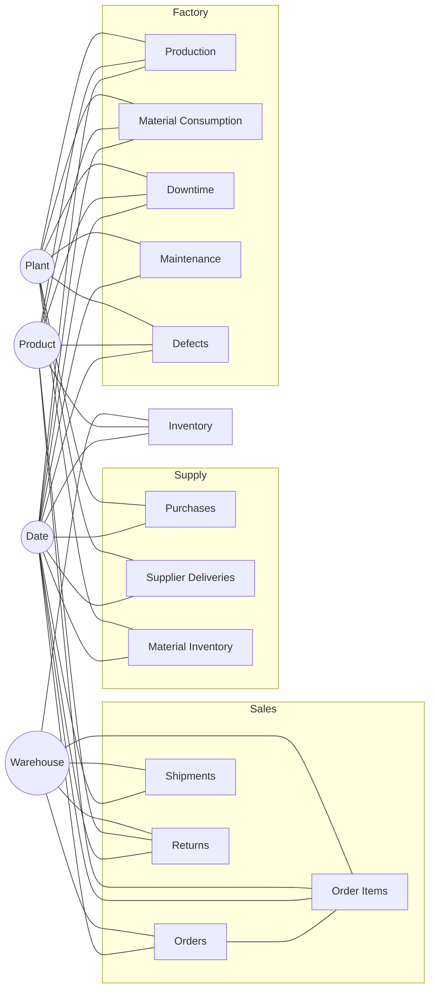

# Power BI Semantic Model Specification

Mode: **Import** (about 3.1M rows in total; the largest tables are Inventory 1.2M, Order Items 0.6M, Material Consumption 0.56M). Source: PostgreSQL schema `dw` plus view `analytics.v_demand_supply_status`.

## 1. Model shape

A classic **constellation (galaxy) of star schemas**: 13 facts share conformed dimensions (Date, Product, Warehouse, Plant, Customer, Material, Supplier). There are no fact-to-fact relationships; fact tables are compared through shared dimensions with measures.

## 2. Table names, roles and Power Query sources

See `power_query_load.m.txt`. Rename each query to the **Model name** below (DAX in `powerbi/dax` uses these names).

| Model name | Source | Role | Rows (approx.) |
|---|---|---|---|
| Date | `dw.dim_date` | Dimension (date table) | 1,461 |
| Customer | `dw.dim_customer` | Dimension | 20,000 |
| Product | `dw.dim_product` | Dimension | 500 |
| Supplier | `dw.dim_supplier` | Dimension | 111 |
| Material | `dw.dim_material` | Dimension | 68 |
| Warehouse | `dw.dim_warehouse` | Dimension | 15 |
| Plant | `dw.dim_plant` | Dimension | 5 |
| Machine | `dw.dim_machine` | Dimension | 110 |
| Carrier | `dw.dim_carrier` | Dimension | 5 |
| Promotion | `dw.dim_promotion` | Dimension | 24 |
| Location | `dw.dim_location` | Dimension (shipment destination only) | 38 |
| Order Status | `dw.dim_order_status` | Dimension | 5 |
| Return Reason | `dw.dim_return_reason` | Dimension | 6 |
| Defect Type | `dw.dim_defect_type` | Dimension | 5 |
| Downtime Type | `dw.dim_downtime_type` | Dimension | 6 |
| BOM | `dw.bridge_product_material` | Bridge (hidden) |  |
| Orders | `dw.fact_orders` | Fact (order grain) |  |
| Order Items | `dw.fact_order_items` | Fact (order-line grain) |  |
| Shipments | `dw.fact_shipments` | Fact |  |
| Returns | `dw.fact_returns` | Fact |  |
| Inventory | `dw.fact_inventory_snapshot` | Fact (weekly snapshot) |  |
| Material Inventory | `dw.fact_material_inventory_snapshot` | Fact (weekly snapshot) |  |
| Purchases | `dw.fact_purchases` | Fact |  |
| Supplier Deliveries | `dw.fact_supplier_deliveries` | Fact |  |
| Production | `dw.fact_production` | Fact |  |
| Material Consumption | `dw.fact_material_consumption` | Fact (derived) |  |
| Downtime | `dw.fact_downtime` | Fact |  |
| Maintenance | `dw.fact_maintenance` | Fact |  |
| Defects | `dw.fact_defects` | Fact |  |
| Product Supply Position | `analytics.v_demand_supply_status` | Analytical view (1 row per product) | 500 |
| _Measures | `(empty table)` | Measure container | 0 |

(Fact row counts: see `docs/data_dictionary.md`.)

## 3. Relationships

All are **many-to-one, single direction (dimension filters fact)** unless noted. There are **no bidirectional relationships** and no many-to-many relationships.

| # | From (many) | Column | To (one) | Column | Active | Note |
|---|---|---|---|---|---|---|
| 1 | Orders | `order_date_key` | Date | `date_key` | Yes | primary date for this fact |
| 2 | Orders | `ship_date_key` | Date | `date_key` | **No** (inactive) | role-playing date |
| 3 | Orders | `promised_date_key` | Date | `date_key` | **No** (inactive) | role-playing date |
| 4 | Order Items | `order_date_key` | Date | `date_key` | Yes | primary date for this fact |
| 5 | Shipments | `ship_date_key` | Date | `date_key` | Yes | primary date for this fact |
| 6 | Shipments | `order_date_key` | Date | `date_key` | **No** (inactive) | role-playing date |
| 7 | Shipments | `promised_date_key` | Date | `date_key` | **No** (inactive) | role-playing date |
| 8 | Shipments | `delivered_date_key` | Date | `date_key` | **No** (inactive) | role-playing date |
| 9 | Returns | `return_date_key` | Date | `date_key` | Yes | primary date for this fact |
| 10 | Returns | `order_date_key` | Date | `date_key` | **No** (inactive) | role-playing date |
| 11 | Inventory | `snapshot_date_key` | Date | `date_key` | Yes | primary date for this fact |
| 12 | Material Inventory | `snapshot_date_key` | Date | `date_key` | Yes | primary date for this fact |
| 13 | Purchases | `order_date_key` | Date | `date_key` | Yes | primary date for this fact |
| 14 | Purchases | `promised_date_key` | Date | `date_key` | **No** (inactive) | role-playing date |
| 15 | Purchases | `first_received_date_key` | Date | `date_key` | **No** (inactive) | role-playing date |
| 16 | Supplier Deliveries | `received_date_key` | Date | `date_key` | Yes | primary date for this fact |
| 17 | Supplier Deliveries | `order_date_key` | Date | `date_key` | **No** (inactive) | role-playing date |
| 18 | Supplier Deliveries | `promised_date_key` | Date | `date_key` | **No** (inactive) | role-playing date |
| 19 | Production | `date_key` | Date | `date_key` | Yes | primary date for this fact |
| 20 | Material Consumption | `date_key` | Date | `date_key` | Yes | primary date for this fact |
| 21 | Downtime | `date_key` | Date | `date_key` | Yes | primary date for this fact |
| 22 | Maintenance | `date_key` | Date | `date_key` | Yes | primary date for this fact |
| 23 | Defects | `date_key` | Date | `date_key` | Yes | primary date for this fact |
| 24 | Orders | `customer_key` | Customer | `customer_key` | Yes |  |
| 25 | Order Items | `customer_key` | Customer | `customer_key` | Yes |  |
| 26 | Shipments | `customer_key` | Customer | `customer_key` | Yes |  |
| 27 | Returns | `customer_key` | Customer | `customer_key` | Yes |  |
| 28 | Order Items | `product_key` | Product | `product_key` | Yes |  |
| 29 | Returns | `product_key` | Product | `product_key` | Yes |  |
| 30 | Inventory | `product_key` | Product | `product_key` | Yes |  |
| 31 | Production | `product_key` | Product | `product_key` | Yes |  |
| 32 | Material Consumption | `product_key` | Product | `product_key` | Yes |  |
| 33 | Downtime | `product_key` | Product | `product_key` | Yes |  |
| 34 | Defects | `product_key` | Product | `product_key` | Yes |  |
| 35 | BOM | `product_key` | Product | `product_key` | Yes |  |
| 36 | Orders | `warehouse_key` | Warehouse | `warehouse_key` | Yes |  |
| 37 | Order Items | `warehouse_key` | Warehouse | `warehouse_key` | Yes |  |
| 38 | Shipments | `warehouse_key` | Warehouse | `warehouse_key` | Yes |  |
| 39 | Returns | `warehouse_key` | Warehouse | `warehouse_key` | Yes |  |
| 40 | Inventory | `warehouse_key` | Warehouse | `warehouse_key` | Yes |  |
| 41 | Production | `plant_key` | Plant | `plant_key` | Yes |  |
| 42 | Material Consumption | `plant_key` | Plant | `plant_key` | Yes |  |
| 43 | Downtime | `plant_key` | Plant | `plant_key` | Yes |  |
| 44 | Maintenance | `plant_key` | Plant | `plant_key` | Yes |  |
| 45 | Defects | `plant_key` | Plant | `plant_key` | Yes |  |
| 46 | Purchases | `plant_key` | Plant | `plant_key` | Yes |  |
| 47 | Supplier Deliveries | `plant_key` | Plant | `plant_key` | Yes |  |
| 48 | Material Inventory | `plant_key` | Plant | `plant_key` | Yes |  |
| 49 | Production | `machine_key` | Machine | `machine_key` | Yes |  |
| 50 | Material Consumption | `machine_key` | Machine | `machine_key` | Yes |  |
| 51 | Downtime | `machine_key` | Machine | `machine_key` | Yes |  |
| 52 | Maintenance | `machine_key` | Machine | `machine_key` | Yes |  |
| 53 | Defects | `machine_key` | Machine | `machine_key` | Yes |  |
| 54 | Purchases | `material_key` | Material | `material_key` | Yes |  |
| 55 | Supplier Deliveries | `material_key` | Material | `material_key` | Yes |  |
| 56 | Material Consumption | `material_key` | Material | `material_key` | Yes |  |
| 57 | Material Inventory | `material_key` | Material | `material_key` | Yes |  |
| 58 | BOM | `material_key` | Material | `material_key` | Yes |  |
| 59 | Purchases | `supplier_key` | Supplier | `supplier_key` | Yes |  |
| 60 | Supplier Deliveries | `supplier_key` | Supplier | `supplier_key` | Yes |  |
| 61 | Shipments | `carrier_key` | Carrier | `carrier_key` | Yes |  |
| 62 | Order Items | `promotion_key` | Promotion | `promotion_key` | Yes |  |
| 63 | Orders | `order_status_key` | Order Status | `order_status_key` | Yes |  |
| 64 | Order Items | `order_status_key` | Order Status | `order_status_key` | Yes |  |
| 65 | Returns | `return_reason_key` | Return Reason | `return_reason_key` | Yes |  |
| 66 | Defects | `defect_type_key` | Defect Type | `defect_type_key` | Yes |  |
| 67 | Downtime | `downtime_type_key` | Downtime Type | `downtime_type_key` | Yes |  |
| 68 | Shipments | `destination_location_key` | Location | `location_key` | Yes | destination of the shipment |
| 69 | Product Supply Position | `product_key` | Product | `product_key` | Yes | ONE-TO-ONE |

Total: 69 relationships (10 inactive role-playing date relationships).

### Why these choices

* **Role-playing dates**: one Date table, one active relationship per fact, the rest inactive and activated per-measure with `USERELATIONSHIP` (`powerbi/dax/10_role_playing_dates.dax`). Avoids copying the Date table five times.
* **Date table**: mark `Date` as a date table on `full_date`. Relationships use the integer `date_key` (fast, no time part); once marked, time-intelligence functions work through those integer relationships.
* **No Plant -> Machine relationship**: Plant and Machine both relate to the manufacturing facts. Linking them to each other would create two filter paths from Plant to Production (ambiguity). `Machine` therefore carries `plant_name` for the Plant > Line > Machine hierarchy.
* **No Customer/Warehouse/Plant -> Location relationships**: those tables already carry city/country/region. `Location` only serves the shipment *destination* (`Shipments[destination_location_key]`).
* **BOM bridge**: the only many-to-many in the business (product <-> material). It is modelled as a hidden bridge with two one-to-many relationships, both single direction, so there is no ambiguity with Product -> Material Consumption. To list a product's materials, use `[BOM Qty per Unit]` on a visual with `Material[material_name]` on the axis; only materials used by the selected product return a value.
* **Product Supply Position** is one row per product (as-of snapshot), so the Product relationship is one-to-one, single direction.
* **No relationships between facts**; cross-domain analysis happens through shared dimensions (Date, Product, Plant, Warehouse).

## 4. Table and column settings

### Date table
* Mark as date table: `full_date`.
* Sort by column: `month_year` by `month_year_sort`; `quarter_year` by `quarter_year_sort`; `month_name` and `month_short` by `month_num`; `day_name` by `day_of_week_num`.
* Hierarchy **Calendar**: `year_num` > `quarter_year` > `month_year` > `full_date`.  Hierarchy **Fiscal**: `fiscal_year` > `fiscal_quarter` > `month_year`.
* Hide: `date_key` (used only for relationships), `week_start_date`, `month_start_date`, `*_sort` columns.

### Hierarchies on other tables
* Product: `category` > `sub_category` > `product_name`.
* Machine: `plant_name` > `production_line` > `machine_id`.
* Customer: `region` > `country` > `city`.
* Warehouse: `region` > `warehouse_name`.
* Supplier: `country` > `supplier_name`.
* Material: `material_family` > `material_name`.

### Hidden technical columns
Hide in **Report view** (keep in model view) on every table: all `*_key` columns (surrogate keys), `_id` business keys where a readable name exists, `order_count`, `shipment_count`, `delivery_count`, `work_order_count`, and every raw flag/amount column that a measure already wraps (`recognized_*`, `*_flag`, `*_minutes`, `*_units`, `qty_*`, `*_amount`). Users should only see dimension attributes and measures.

### Summarisation
Set **Don't summarize** on every numeric column of every table. All numbers shown on visuals must come from measures.

### Display folders (measures)
| Folder | File |
|---|---|
| 01 E-Commerce | `01_ecommerce.dax` |
| 02 Customers | `02_customers.dax` |
| 03 Inventory | `03_inventory.dax` |
| 04 Suppliers | `04_suppliers.dax` |
| 05 Manufacturing | `05_manufacturing.dax` |
| 06 Logistics | `06_logistics.dax` |
| 07 Time Intelligence | `07_time_intelligence.dax` |
| 08 Demand & Supply | `08_demand_supply.dax` |
| 09 Control Tower | `09_control_tower.dax` |
| 10 Alternate Dates | `10_role_playing_dates.dax` |

### Formatting
* Currency `$#,0`, ratios `0.0%`, counts `#,0`, hours `#,0`, days `0.0`. Set on each measure (`// Format:` comments in the DAX files).
* Theme: `powerbi/theme/chainsight_theme.json` (View > Themes > Browse for themes).

## 5. Performance settings
* Disable *Auto date/time* (File > Options > Current file > Data load) - the model has its own Date table.
* Remove columns you do not use from the largest tables before loading (e.g. `Inventory[unit_cost]` if unused), but keep all columns listed in the measures.
* Keep the Inventory table in Import mode; do not use DirectQuery.

## 6. Model validation checklist

1. Model view shows no relationship ambiguity warnings and no bidirectional arrows.
2. `[Total Revenue]` for all time equals the reference value in `docs/kpi_reference_values.md`.
3. A matrix of `Date[year_num]` x `[Total Orders]` matches reference orders.
4. `Date` has no blank row in any slicer once `is_actuals` page filter is applied.
5. `[OEE]` for the whole company equals the reference value.